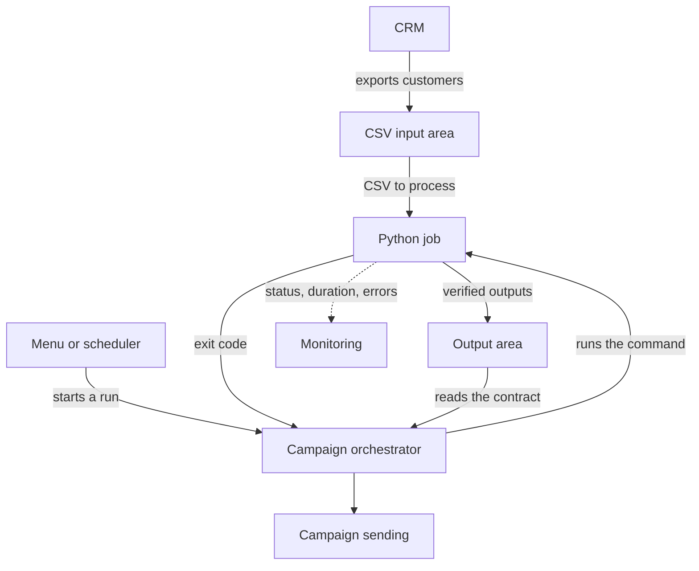

# CRM loyalty profile ingestion

A command-line program that reads one customer-profile CSV export from a supermarket chain's CRM, cleans and validates it, and publishes a canonical customer table with campaign eligibility at export time. It also publishes the rejected rows, the losing duplicates, every warning and a run summary. The customer is hypothetical. Every assumption about it is labelled and listed in [`docs/brainstorming/brainstorming.md`](docs/brainstorming/brainstorming.md), with the points to confirm with a real customer in section 8.

**End user:** the data analyst who prepares the marketing database. **Later integration:** an orchestrator that starts the run, reads the outputs as a contract and sends campaigns.

## Customer context and value

**Assumed customer:** a supermarket chain with a loyalty program. A data analyst prepares the marketing database from CRM exports. The exports are noisy: column names change between exports (schema drift), values arrive in many spellings, and files edited in Excel lose details such as the leading 0 of a phone number.

**Value the solution would create:**

- **Campaigns reach only people who agreed.** A customer is eligible only with consent, an active subscription and a valid contact channel. Unknown never enables a campaign, which lowers the GDPR risk.
- **Less manual cleaning.** The analyst reviews what the run reports instead of fixing the file by hand.
- **No silent data loss.** Every record ends as a customer, a rejected row or a losing duplicate, with the reason, and the totals reconcile.
- **Schema drift becomes a clear decision.** A new column stops the run with a mapping proposal, so the analyst approves it once and the next exports continue.
- **A stable contract.** The campaign orchestrator reads the same versioned files, whatever the export looks like.

These benefits are expected, not measured: the customer is hypothetical.

## Documents

| Document | What it holds |
| --- | --- |
| [`docs/brainstorming/brainstorming.md`](docs/brainstorming/brainstorming.md) | Map of the problem, assumptions A1–A10, decisions D1–D30 with reasons, what was left out and why |
| [`docs/specification/specification.md`](docs/specification/specification.md) | The contract: input, mapping, field rules, row processing, outputs, codes, operations, 69 acceptance cases (AC-01…AC-69) |
| [`openspec/specs/ingestion/spec.md`](openspec/specs/ingestion/spec.md) | The same specification in OpenSpec form (requirements and WHEN/THEN scenarios) |
| [`docs/plan/2026-11-05-ingest-plan.md`](docs/plan/2026-11-05-ingest-plan.md) | Implementation plan: 19 tasks, each with files, interfaces and the tests written before the code |
| [`docs/ai-log.md`](docs/ai-log.md) | What the AI proposed and what was rejected or changed |

## Setup

Python 3.11 or later. Nothing to install: the program and the tests use the standard library only.

Optional on Windows: the `tzdata` package lets the run detect a timestamp in the hour that repeats or is skipped when the clock changes (`TIMESTAMP_AMBIGUOUS_HOUR`). Linux and macOS do not need it. Without it the run works the same and skips that check.

```powershell
py -3.14 -m venv .venv
.venv\Scripts\python -m pip install tzdata
$env:TZ = "Europe/Bucharest"
.venv\Scripts\python -m unittest
```

## Try it in one minute

[`examples/crm_export_sample.csv`](examples/crm_export_sample.csv) is a small synthetic CRM export of 8 records, with invented people. It contains the usual problems: Romanian column names, a duplicate card, a missing card, a row with an extra cell, a phone that lost its leading 0, an invalid email, a zero amount, a customer with no contact channel and an unknown column.

Download the project, then run from its folder:

```
git clone https://github.com/vciocanau/FDE-Adobe
cd FDE-Adobe
```

Windows:

```
py -m ingest run --input examples\crm_export_sample.csv
```

macOS and Linux:

```
python3 -m ingest run --input examples/crm_export_sample.csv
```

The last line printed is `Run published: runs/run_<date>_<time>Z`. That folder holds five files:

| File | What it holds for the sample |
| --- | --- |
| `canonical_customers.csv` | One cleaned row per card: 5 customers, of which 2 are eligible for a campaign, each with the reasons when it is not (consent refused, subscription inactive, no contact channel). |
| `rejected_rows.csv` | The 2 records that cannot become customers (one without a card, one with an extra cell), kept in full with the reason. |
| `duplicates.csv` | The 1 older record of a card that appears twice, with the record that won and why it lost. |
| `warnings.csv` | The 7 things that were fixed or flagged without rejecting a record, such as the phone that lost its 0, the invalid email and the unknown column `Oras`. |
| `run_summary.json` | The totals (8 received = 5 canonical + 2 rejected + 1 duplicate), how each column was mapped, the time and memory of each stage, and the flags. |

The log of the run is in `runs/logs/`. Running the command again creates a new run folder next to the first one; nothing is overwritten.

## Run

Windows:

```
py -m ingest run --input path\to\crm_export.csv
```

macOS and Linux:

```
python3 -m ingest run --input path/to/crm_export.csv
```

| Argument | Default | Meaning |
| --- | --- | --- |
| `--input` | required | CRM CSV export |
| `--output` | `runs` | Folder in which run folders are created |
| `--dictionary` | `mappings/synonyms.json` | Approved column-name synonyms |
| `--approve` | none | Mapping proposal file completed by the analyst |
| `--missing-contact-threshold` | 3 | % of canonical customers without a contact channel above which the source probably broke |
| `--rejection-threshold` | 10 | % of rejected rows above which the rate is reported as unusually high |
| `--memory-warn` / `--memory-stop` | 50 / 80 | % of total memory for a warning / a clean stop |
| `--debug` | off | Keeps the temporary folder of a failed run as `failed_YYYY-MM-DD_HHMMSSZ` |

### Exit codes

| Code | Meaning |
| --- | --- |
| 0 | Run published |
| 1 | Data problem in the file (encoding, unclosed quote, no header, missing card column, …) |
| 2 | Usage, unreadable input, output not writable, run folder already exists |
| 3 | Waiting for the analyst to approve a mapping proposal |
| 4 | Stopped by the memory threshold |
| 5 | Verification failed or unexpected internal error |

Every stop prints one line, `ERROR <CODE> [stage <name>] <message>`. No traceback reaches the operator.

### Approving a new column

When a column is not in the dictionary and the simulated agent proposes a field with a score of 60 or more, the run stops with exit code 3. It writes `runs/mapping_proposals/proposal_<time>Z.json`. The analyst fills in `decision` for each entry: `approve`, `reject` or `change` (with `use_field`). Then the run is repeated with `--approve <that file>`. Approved and changed mappings are added to the dictionary.

## Outputs

Each successful run writes one folder, `runs/run_YYYY-MM-DD_HHMMSSZ` (UTC). The files are written into a temporary folder, verified, and only then renamed, so a run publishes all five files or nothing. Existing run folders are never overwritten.

| File | Content |
| --- | --- |
| `canonical_customers.csv` | One row per card, eligible or not, with `eligible_for_campaign` and `ineligibility_reasons`; unknown columns follow unchanged |
| `rejected_rows.csv` | Every rejected record in full, with all its reason codes in one cell |
| `duplicates.csv` | Every losing duplicate, the winning record and why it lost |
| `warnings.csv` | Every warning, with record number and field |
| `run_summary.json` | Schema version, export date, column mapping, totals, eligibility counts, warnings by code, duration and peak memory of each stage, thresholds and flags |

Totals always reconcile: rows received = canonical + rejected + losing duplicates. The log is written to `runs/logs/` and holds no card, name, email or phone value.

## Architecture

```
CRM CSV ──► read ──────────► clean ─────────────► write ──────────► verify ──► publish (rename)
            strict CSV        field rules           5 files into        re-read files,
            header mapping    rejection             a temporary         reconcile totals
            (dictionary +     duplicates            folder
             simulated agent) eligibility
```

| Module | Responsibility |
| --- | --- |
| `ingest/reader.py` | File checks, delimiter, header, strict record reading |
| `ingest/mapping.py`, `ingest/agent.py` | Dictionary, simulated agent with masked samples, proposal file, approvals |
| `ingest/fields.py` | One rule per field (spec section 6) |
| `ingest/rows.py` | Rejection, duplicates, eligibility, thresholds |
| `ingest/writer.py`, `ingest/publish.py` | Output files, verification, publishing, permissions |
| `ingest/ops.py` | Stage timing, memory readings (Linux, macOS, Windows), memory guard, log |
| `ingest/cli.py` | Arguments, run orchestration, operator messages |

### Target deployment

Only the Python job exists today, and an analyst starts it from the command line. The assumed deployment makes it one step in the orchestrator's flow, started from a menu or by the orchestrator's scheduler; this is to confirm with a real customer. The other boxes show that target.



### Integration options

| Option | How it works | Change needed | Best when |
| --- | --- | --- | --- |
| **Step started by the orchestrator (assumed)** | A menu action or the orchestrator's scheduler runs the command with `--input` and `--output`, then reads the exit code and the outputs | None in the job; the orchestrator adds the call | Both share a host or a storage area |
| Task on a workflow platform | The same command runs in a container, as one task of a workflow | Packaging | Retries, run history and schedules are needed |
| HTTP API around the job | `POST /runs` returns a run id at once; `GET /runs/{id}` returns the status | A small service | The orchestrator runs elsewhere |
| File-arrival event | A new export in storage raises an event that starts the run | A small trigger | No person needs to start the run |
| Customer events | The CRM publishes each change; the same field rules run per customer | A large redesign | Consent changes must arrive within minutes |

In the first option, the exit code tells the orchestrator what to do next:

| Exit code | Orchestrator action |
| --- | --- |
| 0 | Read the run folder named on the last printed line, check the schema version, continue the flow |
| 1 | Show the error line and ask the analyst for a corrected export |
| 2 | Report a configuration or access problem |
| 3 | Open an approval task from the proposal file, then repeat the run with `--approve` |
| 4 | Stop and alert support: the export needs a larger machine or splitting |
| 5 | Stop, alert support and use no output |

This option still needs three additions: an approval screen in place of the hand-edited JSON file, a guard against starting the same export twice, and a way to send run status to monitoring.

## Assumptions

The brief is intentionally vague, so these are guesses to confirm with a real customer. Full wording and status: [`docs/brainstorming/brainstorming.md`](docs/brainstorming/brainstorming.md), section 3.

| # | Assumption |
| --- | --- |
| A1 | The customer is a supermarket chain with a loyalty program, physical stores, web, app and social presence. |
| A2 | The loyalty card is a stable key: exactly 16 digits, one card type. |
| A3 | Each CRM row has at least one contact channel, plus subscription and consent state at export time. Last purchase columns are optional. |
| A4 | An export holds about 100,000 records. |
| A5 | Consent values arrive in many spellings and normalize to yes, no or unknown. |
| A6 | Mapping scores: above 90 safe, 60 to 90 with caution, below 60 no proposal. The score never approves a mapping by itself. |
| A7 | More than 3% of valid-card profiles without a contact channel means the source probably broke. The value is configurable. |
| A8 | An account requires a confirmed email or phone, so a profile with no contact channel should not exist. |
| A9 | The end user is a data analyst who prepares the marketing database. |
| A10 | Excel can drop a phone's leading 0, so nine digits starting with 7 are a Romanian mobile number. The default prefix is +40. |

## Main decisions

- **Identity key** is the 16-digit loyalty card. A row without a valid card is rejected, never guessed (D3, D23).
- **Eligibility** needs consent `yes`, subscription `active` and at least one valid contact channel. Unknown never enables a campaign (D9, D11). It is eligibility at export time, not a send authorization (D12).
- **Duplicates:** the most recent valid interaction wins. When the order cannot be known and the rows disagree on consent or subscription, the customer is not eligible (D20).
- **Strict reading:** extra cells with values, text after a closing quote and an unclosed quote are diagnosed, never silently absorbed (D29).
- **The mapping agent is simulated.** There is no API key. It sees only column names and masked samples, and it never approves a mapping by itself (D6, D8, D24).
- **Zero dependencies** (D18); `tzdata` is optional on Windows.

## Trade-offs

| Choice | Gained | Given up | Revisit when |
| --- | --- | --- | --- |
| Batch CSV instead of an API or events | Simple and robust; fits the 8–10 hour budget | Data is as old as the export, so eligibility holds at export time and the orchestrator must recheck before sending | Consent changes must reach campaigns within minutes |
| Records held in memory instead of streaming | Simple duplicate handling and reconciliation | 1,000,000 records need 3.2 GB; 10,000,000 stop with `MEMORY_LIMIT` | Exports grow far above 100,000 records |
| Every mapping proposal stops the run | A wrong column is never applied silently | A run waits for the analyst | Real data shows which high scores are safe |
| Simulated agent instead of a live model | No API key, repeatable runs, no data sent out | Fewer columns are recognized | An approved provider and privacy review exist |
| Standard CSV reader instead of a custom one | Saves 1–2 hours and keeps less code | A stray quote in an unquoted field is not flagged | Such files appear in practice |
| Card as the only identity key | No wrong matches between people | Rows without a valid card are rejected, not matched by name, phone or email | A GDPR basis for matching exists |
| Python with the standard library only | Versatile: the same code runs on Windows, Linux and macOS, with nothing to install but Python | No encryption of output files; slower than a compiled language or a columnar data library | The customer's PII policy requires encryption, or volumes need faster processing |

## Tests

```
python -m unittest -v
```

The suite has 150 tests. Each test's docstring names the acceptance case it proves (AC-01…AC-69) or the spec section. The 100,000-record volume test runs with `INGEST_VOLUME=1`. Synthetic data comes from `python tools/generate_synthetic.py --rows N --out file.csv --seed 42`; it contains invented names only.

## Performance

Measured runs with synthetic files from the generator (seed 42, same files on both machines, same counts on both). Full record, with the runs before and after each fix: [`docs/performance-log.md`](docs/performance-log.md).

**Cloud sandbox:** Linux, 2 CPUs, 8 GB RAM, Python 3.13

| Run | Records | Input | read | clean | write | verify | total | peak memory | peak / input | outcome |
| --- | --- | --- | --- | --- | --- | --- | --- | --- | --- | --- |
| 1x | 100,000 | 11 MB | 0.8 s | 4.0 s | 0.4 s | 0.4 s | 5.5 s | 437 MB | 39 | published |
| 10x | 1,000,000 | 112 MB | 8.4 s | 42.5 s | 4.6 s | 5.0 s | 60.6 s | 3.2 GB | 29 | published |
| 100x | 10,000,000 | 1.1 GB | – | – | – | – | 0.1 s | – | – | `MEMORY_LIMIT`, exit 4, before reading |

**Windows desktop:** Windows 10, Intel Core i5-6500 (4 cores), 16 GB RAM, Python 3.14

| Run | Records | Input | read | clean | write | verify | total | peak memory | peak / input | outcome |
| --- | --- | --- | --- | --- | --- | --- | --- | --- | --- | --- |
| 1x | 100,000 | 11 MB | 0.7 s | 7.0 s | 0.5 s | 0.6 s | 8.8 s | 340 MB | 30 | published |
| 10x | 1,000,000 | 112 MB | 8.6 s | 63.6 s | 5.1 s | 3.8 s | 81.2 s | 3.2 GB | 29 | published |
| 100x | 10,000,000 | 1.1 GB | – | – | – | – | 0.2 s | – | – | `MEMORY_LIMIT`, exit 4, before reading |
| 100x, stop disabled (experiment) | 10,000,000 | 1.1 GB | failed after 176 s in read | – | – | – | – | memory and page file full | – | `MemoryError`, now reported as `MEMORY_LIMIT`, exit 4 |

Each canonical, rejected and duplicate count is the same on both machines. Time grows linearly with the number of records; the clean stage is about 1.5 times slower on the desktop.

Before reading, the run estimates its peak at 40 MB of memory per MB of input. The measured ratio was 29 to 39 on both machines, so the estimate is on the safe side. If the estimate is above the stop share of total memory, the run stops at once without reading the file. Without this estimate, the 100x run had different endings on the two machines. On Linux the operating system killed it after 19 s. On Windows it filled memory and the page file for 3 minutes and then failed with `MemoryError`. The 100x file needs about 44 GB, so volumes far above 10x need the read and clean stages to stream records instead of keeping everything in memory (D16).

The full test suite also passes on the Windows desktop, including the Windows memory reading. The test suite and the sample run also pass on macOS (MacBook Pro, 8 GB RAM, Python 3.14); the output is in [`docs/macos-test-run.txt`](docs/macos-test-run.txt). No volume run was measured there.

## Known limitations

- A quote in the middle of an unquoted field (`5" pipe`) is read as text and not flagged. The standard CSV reader does not detect it (spec section 4).
- The memory estimate uses one ratio for every file. A customer file with much longer fields or many more columns may need a different ratio. The measured ratio is logged at the end of every run so that a mismatch shows.
- A column that keeps its name but changes its meaning cannot be detected (spec section 5, Out of contract).
- The repeated or skipped local hour is detected only where the time-zone database is available. Windows has it only with the optional `tzdata` package and `TZ` set; without them the check is skipped silently.

- Two small defects left as they are, because neither loses or changes data:
  - `--debug` does not log progress every 10,000 records (spec 10.1 step 5);
  - a memory warning is written twice to the log.

## Not implemented

- A live AI model for mapping (simulated, D8), a real notification for approvals (a JSON file instead), and integration with the orchestrator.
- Encryption of output files (D26); the files are protected by owner-only permissions and the customer's PII policy.
- Streaming for volumes far above 100,000 records (D16).

## AI use

The work followed brainstorming, then specification, then plan, then test-first implementation, with an AI assistant (Claude, with the Superpowers skills). The assistant drafted documents, tests and code. Every rule was decided or approved by the owner, and the assistant's proposals that were rejected or changed are listed in [`docs/ai-log.md`](docs/ai-log.md). Test expectations come from the specification's acceptance cases and were written before the code. Each one was watched failing, then passing. The finished branch was reviewed by a separate AI reviewer that had not seen the work being produced. Its findings and the fixes are recorded in the AI log. Agent instructions are in [`CLAUDE.md`](CLAUDE.md) and [`AGENTS.md`](AGENTS.md).

### Where AI was deliberately not relied on

- **Step-by-step approval instead of autonomous work.** Across the specification and the coding, the AI analysed and proposed, and the owner approved each step before it was applied. Early on the AI ran ahead and applied edits without approval, so the owner set the rule: analysis first, explicit consent for each change.
- **Business rules stayed with the owner.** The AI proposed a 5% missing-contact threshold; the owner set 3%. The owner also added the case of Excel dropping a phone number's leading 0, which the AI had not considered.
- **Simple over clever.** The AI proposed a custom CSV reader. The owner kept the standard Python reader and documented the remaining risk as a known limitation.
- **Measurements over estimates.** The AI proposed extrapolating 10x and 100x from the 100,000-record test. The owner required real runs.
- **No autonomous AI decision at run time.** The mapping agent only proposes. A human approves every mapping, and validation rules stay deterministic.
- **AI output was not trusted by default.** Tests, measurements and independent reviews caught real defects, including one that could publish a customer without consent as eligible. They are listed in [`docs/ai-log.md`](docs/ai-log.md).
